# Database schema and ERD

PBSSU-DB-001 v0.3.0, 2026-11-07 approved logical foundation baseline. No SQL migrations/database changes executed. [Approval record](../planning/STAKEHOLDER-APPROVAL-2026-11-07.md); fields in [dictionary](DATA-DICTIONARY.md).

## Relational invariants

Every table has UUID `id` primary key, UTC `created_at` timestamptz. Mutable rows have `updated_at` and positive integer `version`; immutable evidence rows instead preserve created/occurred/received times. IDs generated by clients are accepted only for supported offline record types and remain subject to validation/tenant authorization.

Tenant tables have NOT NULL `organization_id` referencing organizations.id, UNIQUE `(organization_id,id)`, forced RLS and tenant-leading indexes. Cross-table tenant references always use `(organization_id, foreign_id)` → `(organization_id,id)`. Child records referencing both incident and location/assignment must also constrain `(organization_id,incident_id,location_id)` or `(organization_id,incident_id,assignment_id)` to a matching unique parent tuple. A UUID's global uniqueness alone is insufficient. Organization root uses RLS on `id = current tenant`; authorized platform metadata operations have narrow separate grants. User/permission global tables are never exposed as tenant-wide directories.

No cascading operational deletion. Membership/user/vehicle deactivation preserves evidence. Retention/purge uses approved privileged workflows with audit, legal holds and storage cleanup; not a generic DELETE API. Revoking membership does not remove historical assignments. Domain history and report snapshots remain immutable. Retention dates and erasure exceptions require policy approval.

| Table | Scope / key constraints and relationships |
| --- | --- |
| organizations | Tenant root; unique normalized slug; ONBOARDING/ACTIVE/SUSPENDED. Only guarded first-admin activation can leave ONBOARDING. |
| users | Global restricted identity; unique normalized email; verified timestamp/authentication_version; no password or tenant role columns. |
| sessions | Global restricted identity; user FK; UNIQUE(user_id,id); client_binding_hash, assurance/authentication_version, idle/absolute expiry, PENDING_DELIVERY/ACTIVE/REVOKED/EXPIRED; no raw token. |
| memberships | Tenant; FK user; UNIQUE(org,user), UNIQUE(org,user,id); PENDING_ACTIVATION/ACTIVE/INACTIVE, profile display_name and optional encrypted contact. |
| roles | Tenant; UNIQUE(org,code); only tenant-delegable roles. |
| permissions | Global deployment-managed catalog; UNIQUE(code); domain, sensitivity, valid scope set and privileged-assurance flag. |
| role_permissions | Tenant; composite role FK, global permission FK; UNIQUE(org,role,permission); resource_scope TENANT/ASSIGNED constrained by catalog. |
| membership_roles | Tenant extension; composite membership/role FKs; UNIQUE(org,membership,role). |
| vehicles | Tenant; UNIQUE(org,call_sign); service state. |
| incidents | Tenant; state/category/time/outcome/version; optional encrypted source detail. |
| incident_locations | Tenant; composite incident FK; UNIQUE(org,incident,id), optional geography(Point,4326). |
| incident_personnel | Tenant; composite incident/member FKs; UNIQUE(org,incident,member); role, assignment/release times. |
| incident_vehicles | Tenant; composite incident/vehicle FKs; UNIQUE(org,incident,vehicle); UNIQUE(org,incident,id). |
| movement_logs | Tenant append-only; matching incident/vehicle-assignment tuple; optional matching location tuple; correction FK same incident. |
| situation_updates | Tenant append-only; matching incident/location tuple; author membership; risk, optional point, correction FK same incident. |
| incident_media | Tenant; matching incident/location and optional update tuple; unique server storage key; checksum/scan/access states. |
| agencies | Tenant directory; UNIQUE(org,name); no verified official integration implied. |
| incident_agencies | Tenant; composite incident/agency FKs; UNIQUE(org,incident,agency); involvement evidence, no inferred acknowledgement. |
| incident_victims | Tenant restricted; composite incident FK; minimized encrypted detail; no general list/export exposure. |
| report_counters | Tenant extension; UNIQUE(org,report_year); locked next_sequence allocation. |
| reports | Tenant; composite incident FK; UNIQUE(org,incident,id), UNIQUE(org,incident,revision), UNIQUE(org,report_year,sequence,revision); one report family per incident; reference shared across revisions. Prior revision FK includes tenant/incident. |
| report_approvals | Tenant immutable decision; composite report/member FKs; UNIQUE(org,report_id); decision/version/snapshot digest. |
| audit_logs | Tenant append-only; actor identity, action/result/resource UUID and redacted metadata. |
| sync_operations | Tenant; UNIQUE(org,actor_user_id,operation_id); request hash/outcome/expiry; one transaction with mutation. |
| change_events | Tenant extension; increasing internal change_seq; entity/tombstone and visibility scope for pull. |
| organization_settings | Tenant; UNIQUE(org,key); typed allowlisted value/version, no secrets. |
| notification_deliveries | Tenant; composite incident FK where present; internal delivery attempts only, not agency acknowledgement. |
| outbox_jobs | Tenant extension; job kind/reference/deduplication key/status/lease; UNIQUE(org,deduplication_key). |

| password_credentials | Global restricted identity; UNIQUE(user_id), user FK; Argon2id PHC hash and change/rehash timestamps; never API-projected. |
| session_refresh_tokens | Global restricted identity; composite (user_id,session_id) FK sessions; UNIQUE(token_hash), UNIQUE(user_id,id); predecessor FK (user_id,session_id,parent_id) to matching unique tuple; one active successor per parent, never cross-user/session lineage. |
| mfa_credentials | Global restricted identity; user FK; UNIQUE(user_id,id); encrypted TOTP seed/key reference, lifecycle and last accepted step; at most one ACTIVE TOTP per user, pending replacement preserves current factor. |
| recovery_codes | Global restricted identity; FK (user_id,mfa_credential_id) to matching credential; UNIQUE(code_hash); consumed_at is irreversible. |
| auth_challenges | Global restricted identity; user FK; optional (user_id,session_id) FK; optional (invitation_organization_id,invitation_id) composite FK; binding hash/purpose/expiry/attempt cap/authentication_version; single consumption. |
| account_action_tokens | Global restricted identity proof index; UNIQUE(token_hash), user FK where known; nullable invitation tuple FK to organization_invitations; INVITATION/VERIFY_EMAIL/RESET_PASSWORD/CHANGE_EMAIL, purpose-bound expiry/consumption/authentication_version. |
| organization_invitations | Tenant, forced RLS; kind FIRST_ADMIN/MEMBER; encrypted target email/digest, status/expiry; bound_user_id? FK users; inviter membership or platform_grant FK depending kind; accepted identity cannot differ from verified recipient. |
| invitation_roles | Tenant, forced RLS; composite invitation/role FKs; UNIQUE(org,invitation,role); reserves intent only, never effective authority. |
| identity_audit_logs | Global restricted append-only security audit; optional actor/subject user FKs, action/result/reason enums/resource UUID/correlation/time; no payloads, tokens, seeds or hashes; inaccessible to tenant audit API. |
| identity_delivery_jobs | Global restricted identity delivery outbox; user/account-action/MFA references where needed; encrypted short-lived delivery envelope and purpose; no secrets in ordinary outbox_jobs, notification_deliveries or operational audits. |
| platform_grants | Global restricted bootstrap capability; user FK and global platform-domain permission FK; UNIQUE(user,permission); current active/revoked state checked, no tenant or operational permissions. |

| credential_handoffs | Restricted global; user FK; composite (user_id,session_id), (user_id,challenge_id) and (user_id,mfa_credential_id) FKs when present; exact purpose/client/version/binding; encrypted TTL-bound material; READY/CONSUMED/EXPIRED/REVOKED, one atomic consumption. No plaintext secret projection except dedicated release. |

Blueprint entities are preserved. The original extensions sessions, membership_roles, report_counters, change_events and outbox_jobs support secure sessions, multi-role membership, concurrency and reliable synchronization/background work. No separate personnel identity: memberships hold tenant profiles while users hold login identity.

## ERD

All operational arrows imply tenant composite foreign keys. Global references (users/permissions) are explicitly exceptional.

```mermaid
erDiagram
  organizations ||--o{ memberships : contains
  users ||--o{ memberships : joins
  users ||--o{ sessions : authenticates
  users ||--o| password_credentials : authenticates
  sessions ||--o{ session_refresh_tokens : rotates
  users ||--o{ mfa_credentials : enrolls
  mfa_credentials ||--o{ recovery_codes : protects
  users ||--o{ auth_challenges : proves
  users |o--o{ account_action_tokens : verifies
  organizations ||--o{ organization_invitations : invites
  organization_invitations ||--o{ invitation_roles : reserves
  roles ||--o{ invitation_roles : intends
  organization_invitations |o--o{ account_action_tokens : binds
  organization_invitations |o--o{ auth_challenges : activates
  users |o--o{ identity_audit_logs : records
  users |o--o{ identity_delivery_jobs : receives
  users ||--o{ platform_grants : receives
  users ||--o{ credential_handoffs : binds
  sessions |o--o{ credential_handoffs : delivers
  auth_challenges |o--o{ credential_handoffs : proves
  mfa_credentials |o--o{ credential_handoffs : provisions
  permissions ||--o{ platform_grants : restricts
  organizations ||--o{ roles : defines
  memberships ||--o{ membership_roles : receives
  roles ||--o{ membership_roles : grants
  roles ||--o{ role_permissions : grants
  permissions ||--o{ role_permissions : catalogs
  organizations ||--o{ vehicles : owns
  organizations ||--o{ incidents : owns
  incidents ||--o{ incident_locations : monitors
  incidents ||--o{ incident_personnel : assigns
  memberships ||--o{ incident_personnel : serves
  incidents ||--o{ incident_vehicles : assigns
  vehicles ||--o{ incident_vehicles : serves
  incident_vehicles ||--o{ movement_logs : records
  incident_locations |o--o{ movement_logs : locates
  incident_locations ||--o{ situation_updates : receives
  incidents ||--o{ incident_media : attaches
  situation_updates |o--o{ incident_media : illustrates
  incidents ||--o{ incident_agencies : records
  agencies ||--o{ incident_agencies : participates
  organizations ||--o{ agencies : maintains
  incidents ||--o{ incident_victims : restricts
  organizations ||--o{ report_counters : allocates
  incidents ||--o{ reports : versions
  reports ||--o| report_approvals : decides
  organizations ||--o{ audit_logs : audits
  organizations ||--o{ sync_operations : deduplicates
  organizations ||--o{ change_events : sequences
  organizations ||--o{ organization_settings : configures
  organizations ||--o{ notification_deliveries : records
  organizations ||--o{ outbox_jobs : queues
```

## Constraints, indexes and migration acceptance

Indexes: incidents `(organization_id,status,occurred_at DESC,id)`; observations/movements `(organization_id,incident_id,occurred_at,id)`; reports `(organization_id,incident_id,revision)`; change events `(organization_id,change_seq)`; audit `(organization_id,created_at,id)`; sync unique key; GiST on location/update points for scoped spatial queries. Nullable location means no location supplied, never a synthetic zero coordinate.

Enforce allowed state/risk enums, latitude/longitude validation before geography conversion, positive versions, report sequence/revision >0, paired GPS coordinates and movement correction consistency. Report status transitions, submitted snapshot immutability and approval uniqueness require database protections plus service transactions; immutable tables grant INSERT/SELECT only to runtime, with narrowly scoped system state updates for media/sync delivery.

Report database guards must also enforce that revision 1 has no predecessor and owns its allocated reference, later revisions name the immediately preceding version of that same incident, and report_year/sequence/report_number never change across the family. Service checks alone do not replace these invariants. Approval freezes decision provenance; API report reads include the separate immutable approval record when present.

Migrations must create tenant columns, composite constraints, RLS policies (both USING and WITH CHECK), grants and indexes together. Verify new-table inventory fails CI for missing RLS. Execute migration/restore/rollback rehearsals in disposable databases later. Choose ORM and supported PostgreSQL/PostGIS pairing before M01 schema implementation; document safe PostGIS extension installation privileges separate from runtime.

## Approved identity constraints and access boundaries

All 40 entities are logical only. Identity tables are global because one login spans organizations; they are not generic RLS exemptions for operational access. Restricted identity/bootstrap credentials and narrowly reviewed repository interfaces may access only their documented proof/subject rows; operational runtime cannot list credentials, global audits or platform grants. Tenant organization_invitations/invitation_roles use forced RLS and composite FKs exactly like other tenant tables. Organization root uses id-scoped policies, ONBOARDING denies ordinary tenant operations.

Before membership exists, a restricted identity resolver can look up only a high-entropy account_action_tokens digest/purpose, establish the trusted invitation tuple from that row, then access that invitation in a transaction with server-derived context. A client-supplied invitation/organization UUID or email is never authority. Optional invitation reference pairs are both null or both present. For a required user/organization prefix plus optional session/inviter/parent ID, keep the prefix non-null and condition only on the optional identifier; do not apply MATCH FULL that rejects valid prefix-only rows. Validate subject/user/session matches across proof, factor and invitation. The [machine-readable identity relation inventory](IDENTITY-RELATIONSHIPS.json) captures referenced unique keys and tuple scope without executing DDL. No global proof row grants arbitrary tenant table SELECT.

Onboarding creates organization/locked role template/invitation/intent/token hash/identity-delivery job and redacted identity audit atomically; no active membership_roles. Acceptance consumes the proof and creates/reuses only a PENDING_ACTIVATION membership. Atomic activation locks invitation, target membership, relevant grants and organization; rechecks accepted recipient, email verification, current authentication_version, required MFA including intended privileged grants, nonexpired/nonrevoked invite and current inviter/platform authority. It installs only reserved tenant roles, activates membership and (FIRST_ADMIN only) organization. A first-admin invitation is permanently limited to Organization Admin; no operator/commander/platform grants. Concurrent activation has one winner. Notification dispatch is not invitation acceptance or activation.

Unique partial indexes/transactional guards enforce at most one active factor, one active first-admin invitation per onboarding organization, one active refresh successor per predecessor and at most one active pending invitation per organization/email digest. Expiry/revocation/consumption cannot be reversed; re-invitation creates a new proof and reservation. Pending memberships have no effective role grants. Ordinary PATCH/role APIs cannot activate pending/inactive membership or widen self-held grants. Report/incident rules remain unchanged.

No cross-row CHECK substitutes for activation/replay invariants: use appropriate unique/composite constraints, row locks and reviewed triggers/functions in future migrations. Failed identity mutations and their successful audits share a transaction; denials use a separate protected append writer. Token digests, credential hashes, encrypted seeds/envelopes and recovery-code hashes never enter audit payloads or response projections.

See [identity lifecycle](../api/IDENTITY-LIFECYCLE.md) and [authentication](../security/AUTHENTICATION-ARCHITECTURE.md). [ADR-010](decisions/ADR-010-DATA-ACCESS-MIGRATIONS.md) remains a pending Kysely/PostgreSQL recommendation. Database RLS/transaction/pool claims remain unexecuted runtime acceptance requirements. C-02 is resolved through the explicit [dedicated handoff](../security/CREDENTIAL-HANDOFF.md); mock/production adapter execution remains separately gated.

## Approved handoff storage

credential_handoffs stores user_id, optional same-user session_id/challenge_id/mfa_credential_id, purpose, original client_kind, authentication_version, client_binding_hash, encrypted_material/key_ref, expiry and one-way consumption/revocation state. Add UNIQUE(user_id,id) on auth_challenges for same-subject references. Require a valid proof source for each purpose and at most one READY handoff per source/purpose; invalidate old pending material on regeneration. PENDING_DELIVERY sessions grant no API authority until successful SESSION redemption. Consumption/purge and redacted identity audit commit atomically; no raw material replay or generic secret query endpoint. Mock mail carries invitation/reset proof only; no MFA seed/code email and no real outbound in M01.
