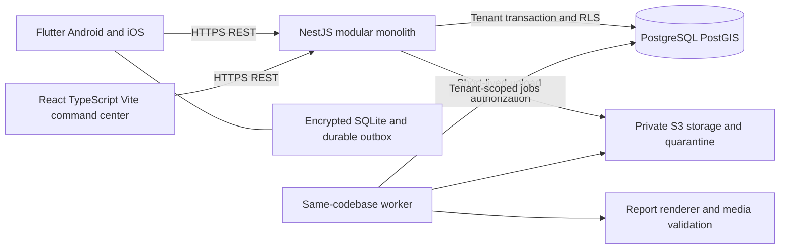

# System architecture

PBSSU-ARCH-001 v0.3.0, 2026-11-07. Approved foundation under [owner record](../planning/STAKEHOLDER-APPROVAL-2026-11-07.md); operational feature policies and runtime verification remain gated.

## Boundaries and module ownership

One deployable backend initially, with explicit module services and no client database access. Worker processes may run from the same codebase for scans/rendering; they do not establish microservices. Reliable jobs use transactional database outbox records, avoiding an unapproved queue dependency.

| Blueprint module | Responsibilities / dependencies |
| --- | --- |
| M01 Organization | Tenant identity/onboarding; depends on M02 identity and M13 audit foundation. |
| M02 Identity/RBAC | Global users/sessions, tenant memberships, roles/permissions, context selection. |
| M03 Personnel | Tenant member profile and operational availability, depends M01/M02. |
| M04 Vehicles | Tenant vehicle register, depends M01/M02. |
| M05 Incidents | Lifecycle/locations and own-incident authorization, depends M01/M02. |
| M06 Dispatch/assignment | Human-authorized member/vehicle coordination, depends M03/M04/M05. |
| M07 Monitoring | Per-location observations/risk, depends M05/M06. |
| M08 Updates/GPS/media | Append-only evidence and quarantine, depends M07/M13. |
| M09 Movements | Append-only vehicle event history, depends M06. |
| M10 Sync | Durable idempotent operations and authorized pull, depends M07/M08/M09. |
| M11 Reports | Frozen versions, approval, exports, sequence allocation; depends M05–M09/M13. |
| M12 Command center | Read models/dashboard; calls authorized services, no separate data authority. |
| M13 Audit/security | Cross-cutting authorization, redacted audit and telemetry. |
| M14 Configuration | Versioned organization settings, depends M01/M02/M13. |

## Tenant request protocol

1. Verify token signature/issuer/audience/expiry and session revocation. Obtain user identity from verified credentials.
2. `X-Organization-Id` is an untrusted selector, never authority. Resolve active membership server-side and load role permissions for that organization on every protected operation. Ignore stale role claims in tokens.
3. Reject tenant IDs in write DTOs (unknown fields rejected). Set organization_id from resolved context. Check resource authorization including responder assignment and sensitive-data scope.
4. Begin transaction using a non-owner, non-superuser, NOBYPASSRLS runtime role. Set transaction-local tenant/user context with parameterized calls. Missing context must fail closed. Execute all ORM/raw queries within that transaction. Connection-pool reuse cannot carry context to the next request.
5. Tenant predicates, composite constraints and ENABLE/FORCE RLS apply on SELECT/INSERT/UPDATE/DELETE with USING and WITH CHECK. Audit and outbox writes commit with the domain mutation.
6. Worker jobs load trusted tenant references, recheck current authorization where acting for users, then establish the same transaction scope. Cache keys, job IDs, export/object access and dashboard projections include tenant scope.

Global identities and permission catalog have separate services and narrowly granted DB access. Organization onboarding is a narrow platform operation that creates an ONBOARDING root and FIRST_ADMIN invitation/intended-role reservation, not active membership. Restricted identity proof acceptance/required MFA precedes explicit atomic activateInvitation; the platform actor gains no operational read privileges. Platform organization listing exposes onboarding metadata only. Membership discovery returns only the authenticated user's memberships. Bootstrap and credential storage access must be tested independently of operational RLS; no general SECURITY DEFINER query escape hatch.

## Proposed role capabilities

M00.1 proposes a complete [permission catalogue and role model](../security/AUTHORIZATION-MODEL.md), [local authentication architecture](../security/AUTHENTICATION-ARCHITECTURE.md) and [toolchain/database assessment](FOUNDATION-COMPATIBILITY.md). Q-01/Q-03/backend Q-04 are approved as of 2026-11-07; exact patches/images/device/runtime and operational feature gates remain. The broad table below is the earlier illustrative view; exact candidate grants/conditions come from the M00.1 catalogue, including explicitly granted redacted audit reads for org admins/auditors and narrowed report revision visibility. No platform privilege implies operational access.

| Capability | Platform admin | Org admin | Operator | Commander | Responder | Auditor |
| --- | --- | --- | --- | --- | --- | --- |
| Organization onboarding | Yes | No | No | No | No | No |
| Own organization/config/membership/vehicle admin | No | Yes | No | No | No | No |
| Incident create/edit/dispatch | No | No* | Yes | Yes | No | No |
| Incident/location operational read | No | Yes | Yes | Yes | Assigned | Permitted |
| Field update/movement/media | No | No* | Yes | Yes | Assigned | No |
| Close/cancel incident | No | No* | No | Yes | No | No |
| Draft/submit report | No | No* | Yes | Yes | No | No |
| Approve report | No | No* | No | Yes, different submitter | No | No |
| Approved redacted export | No | Yes | Yes | Yes | No | Permitted |
| Victim details / audit | No | Explicit grant | Explicit grant | Explicit grant | No | Explicit grant |

`*` Additional operational roles may be assigned explicitly; org admin is not an implicit universal role. Permissions are additive but constrained by assignment, field sensitivity and maker/checker policy. Backend role edits cannot grant platform capabilities or permissions the grantor cannot delegate. Q-01 approves the exact role catalogue; operational transition policy Q-02 remains.

## Offline and synchronization

Encrypted SQLite is partitioned by organization and user; keys reside in OS secure storage. Local UUIDs identify records; operations have separate UUIDs and monotonically increasing local queue position. Mobile captures observations, movements and media metadata offline; incident lifecycle, assignments, RBAC and approvals stay online-only.

Push processes bounded operations independently in submitted order; each domain mutation, audit entry and sync result commits in one DB transaction. Unique `(organization_id, actor_user_id, operation_id)` plus canonical payload hash provides at-most-once effect: identical replay returns prior outcome, changed payload with same key returns 409. Concurrent duplicate submissions serialize. Membership/permission checks precede receipt lookup; revoked users cannot retrieve old receipts. Dependency on an unacknowledged parent yields retryable dependency result, never silent discard.

Pull uses an opaque tenant/user/scope-bound cursor over a server sequence in `change_events`. Return only authorized changes and deletion tombstones, never global sequence values. Visibility changes trigger scoped resnapshot/cache purge; membership revocation invalidates cursors. Proposed cursor/offline horizon 30 days, receipts 90 days (Q-05); expired cursor returns 410 and requires safe resnapshot that preserves pending outbox for review. Interrupted pull checkpoint commits with local records. Same-device organization switch cannot send the old tenant's outbox under the new context.

Versioned updates require `base_version` equal to current integer version. Append-only observations avoid overwrite; corrections reference the superseded observation. No last-write-wins for lifecycle, assignments or approvals. Media bytes upload separately; sync never implies successful upload. Server confirmations drive visible queue state.

## Reporting, storage and recovery

Allocate a report number once per organization/year using a locked counter row, unique constraints and one transaction. Each revision stores a frozen structured snapshot with source versions, classification, schema version and digest. Submission locks content; approval atomically records decision/version and signed-in actor. A new revision never mutates old approved content. Export generation reads only an approved snapshot; default exports omit victim/private contact details and exact GPS. Privileged inclusion needs explicit policy and audit, currently deferred. User explicitly copies/downloads export; no automated WhatsApp or agency delivery.

Private storage keys are generated by the server under tenant prefixes; clients cannot choose object paths. Upload grant is size/type/checksum-bound, short-lived, writes only to quarantine. Scan, file-signature/decode checks and metadata stripping precede READY. Download grants require fresh tenant/resource checks. Report artifacts share these controls. Encryption, private backup credentials, restore drills and retention controls are release gates.

## Technical references

RLS owner/bypass limitations and FORCE behavior: [PostgreSQL row security](https://www.postgresql.org/docs/current/ddl-rowsecurity.html). File quarantine and validation design: [OWASP file upload guidance](https://cheatsheetseries.owasp.org/cheatsheets/File_Upload_Cheat_Sheet.html). Version pinning of PostgreSQL/PostGIS remains Q-04.

M00.1 recommends PostgreSQL18/PostGIS3.7 and Kysely/pg with transaction-explicit repositories, subject to approval and runtime verification. Narrow identity access and application role/scope checks remain necessary alongside RLS. A compromised backend credential can set arbitrary custom tenant settings; RLS does not replace SQL injection prevention or trusted context resolution. See ADR-010 and the compatibility assessment for pooling/migration acceptance gates.

## M00.2 candidate identity freeze

OpenAPI0.3.0 contains 75 exact operations; the [identity lifecycle](../api/IDENTITY-LIFECYCLE.md), [40-entity schema](DATABASE-SCHEMA.md), dictionary and traceability now align challenge/proof/MFA/session/invitation states. Global password/refresh/MFA/proof/platform-grant stores and identity audits are separate from tenant operational access. Invitation/intent tables use tenant RLS/composite FKs. Membership activation is not an arbitrary admin PATCH. First admin cannot gain operational roles implicitly.

Generic API response DTOs/headers contain only safe metadata/handles. C-02 is resolved explicitly by [one-time credential handoff](../security/CREDENTIAL-HANDOFF.md); only that dedicated proof-bound operation releases authorized material or web cookies. credential_handoffs is restricted global storage; initial sessions remain PENDING_DELIVERY until redemption, and no handoff adds tenant roles. M01 mock/synthetic mail only; production delivery remains unauthorized. This is approved design, not implemented/runtime-verified security.
