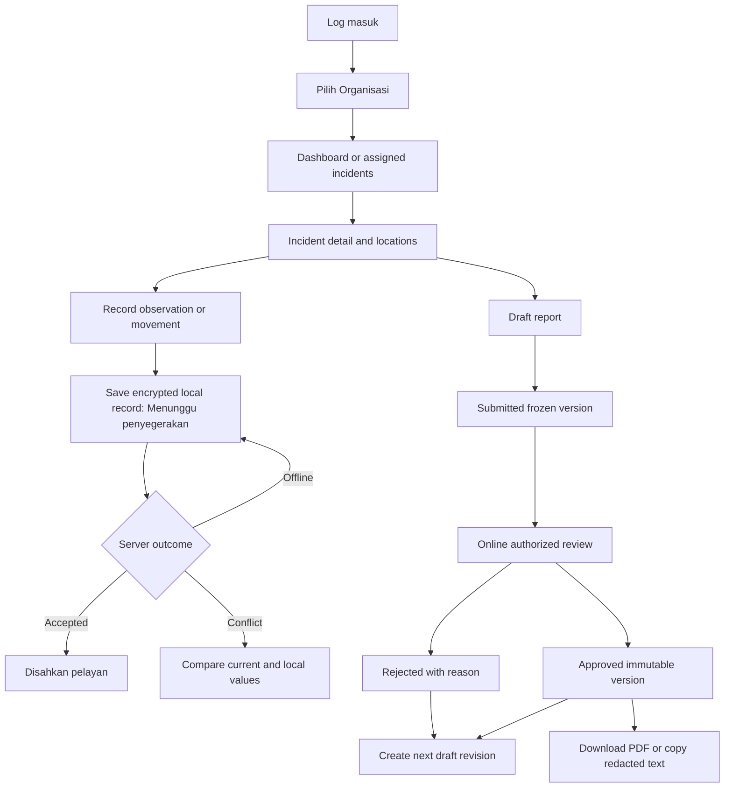

# UI/UX and screen-flow specification

PBSSU-UX-001 v0.1; proposed for Bahasa Melayu stakeholder review. UI permissions mirror backend authorization, and hidden controls never substitute for it.

## Information architecture

| Surface | Screens / main behavior |
| --- | --- |
| Shared access | Log masuk; session recovery; Pilih Organisasi; explicit current organization banner; membership revoked/expired session states. |
| Tenant administration | Organization details/settings; Ahli list/profile/roles; Kenderaan list/status; confirmation of sensitive grants/deactivation. |
| Web command center | Papan Pemuka counts and map; incident filter/list/detail; lifecycle timeline; assignments and movement history; multi-location observation panel; pending reports; permitted audit history. |
| Mobile field app | Assigned incidents; cached incident detail; location list and optional map; new observation/risk/photo; movement event form; outbox and conflict review. |
| Reporting | Version list; draft sections and missing evidence; submit confirmation; online review with approve/reject reason; approved read-only view; redacted PDF download/text copy. |
| Platform admin | Organization onboarding metadata; no incident dashboard or implicit operational-content access. |

## Screen flows

## Interaction acceptance

Always show current organization and connectivity independently. Organization switching warns about pending local entries and preserves them in the original partition; purge revoked cached data when revocation is known. Explain that disconnected devices cannot learn immediate revocation; local unlock timeout and retention limit bound exposure. Queue states: saved locally, uploading, confirmed, conflict, rejected and retry needed. Never show a green server-confirmed badge before acknowledgement.

Incident status and report approval are separate labels. A human confirmation records assignments without wording implying official dispatch acceptance. Cancellations/closure show reason, current version and authorized actor; unavailable transitions show an explanation. Approval requires connectivity, fresh identity and maker/checker validation. Exports show exact approved revision, approval time, classification and redaction notice. Text copy/download is a user action; no delivered/acknowledged badge is inferred.

Location labels remain usable without GPS or maps. Camera/GPS permissions are just-in-time and optional; refusal preserves manual entry. Offline lists display last sync time and stale-data warnings. Conflict screen preserves local evidence, identifies fields changed and offers review/new-operation submission, not silent overwrite.

Primary BM labels with translation keys; dates rendered `05/11/2026 17:00 MYT` while API uses UTC. Proposed touch targets >=48 logical pixels, text scaling to 200%, sufficient contrast, focus order/keyboard access, screen reader labels, status text/icons as well as color, daylight and glove-oriented field usability tests. Web accessibility target is proposed WCAG 2.2 AA, subject to validation.

Forms show field-specific validation and prevent duplicate taps; server idempotency remains authoritative. Empty/permission-denied/offline/expired-cursor/upload-rejected states have distinct recovery instructions without disclosing another tenant's resource existence. No real personal details, banking fields or operational images appear in prototypes.

## M00.2 identity flows (candidate)

Login first factor → restricted bound challenge (email verification/MFA enrollment/MFA verification) → verified identity/session metadata. Invite request only queues intent; recipient acceptance → PENDING_ACTIVATION → required MFA → explicit activation. ONBOARDING roots and pending memberships never open operational screens. Existing users authenticate before accepting an invite; entering a new password there cannot reset an existing account. A fresh activation challenge follows consumed MFA proof.

No generic UI-response DTO includes token/TOTP/code material. C-02 explicitly uses a dedicated one-time handoff: authenticated enrollment renders only its bound setup material locally, recovery codes display once after required proof, and web session cookies remain HttpOnly. A failed/expired handoff needs fresh proof; no fake provisioning/login success or raw response replay. Password reset returns generic accepted status, preserves MFA and returns to login. Session list contains metadata only; logout must revoke even after access expiry. No public manual MFA reset/admin bypass screen.
